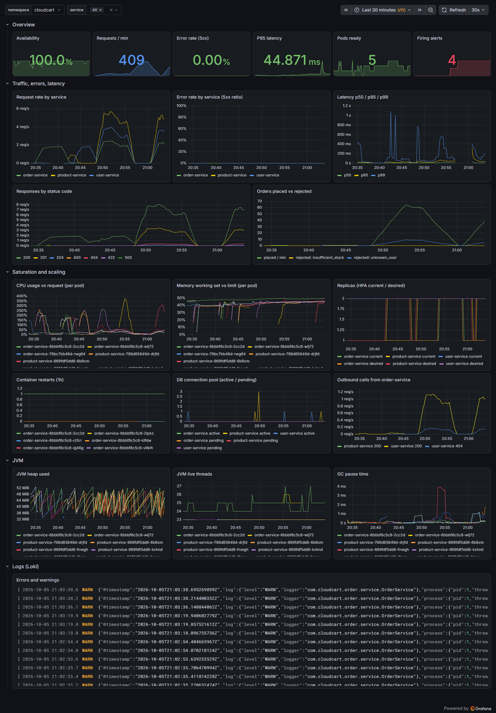
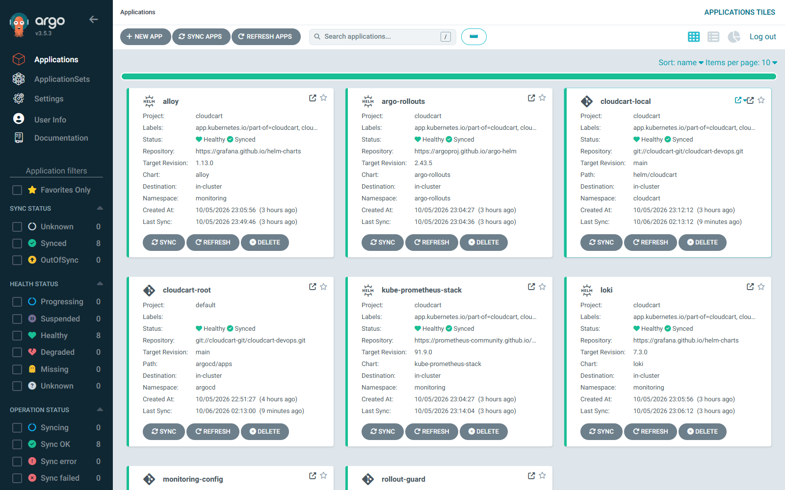
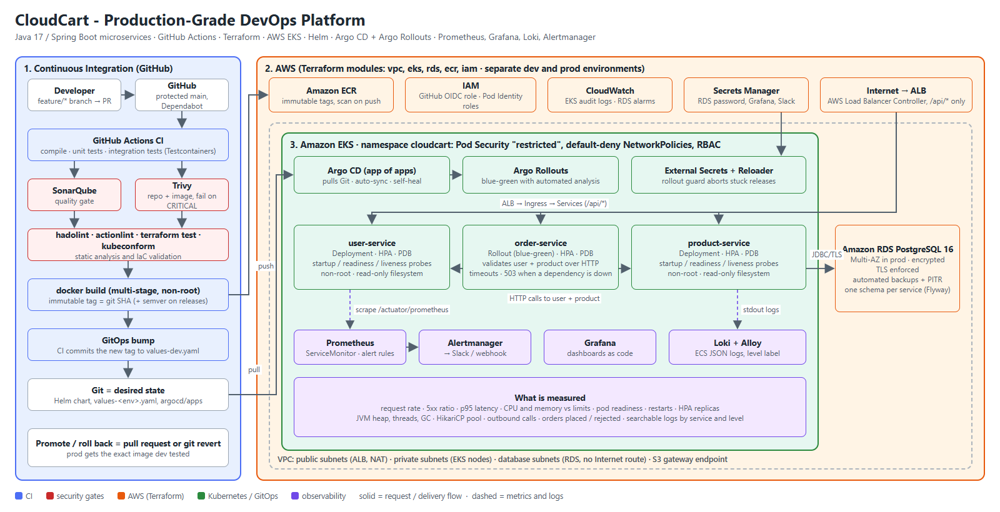
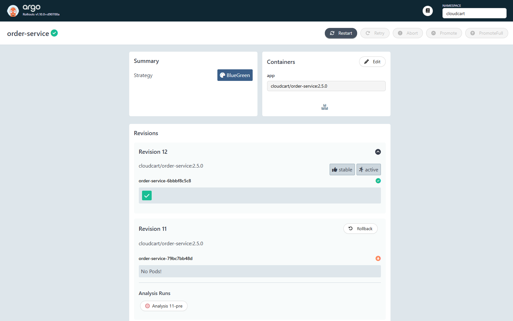
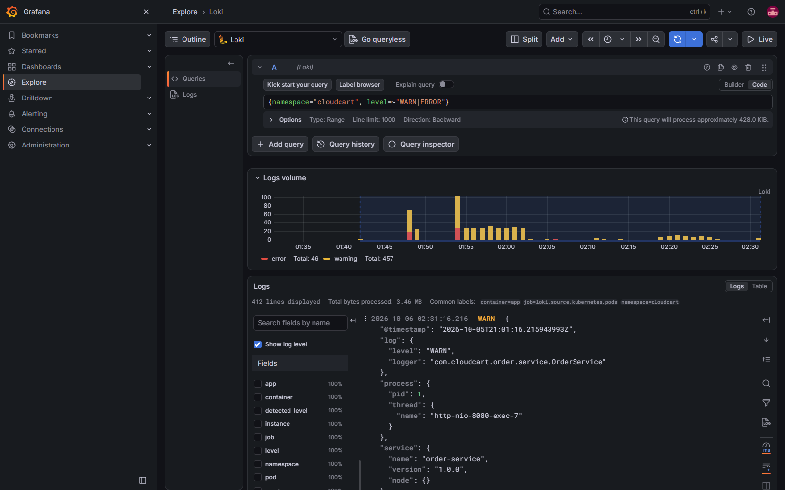

# CloudCart: Production-Grade DevOps Platform

**Java 17 / Spring Boot microservices · Docker · GitHub Actions · Trivy · SonarQube · Terraform · AWS (VPC, EKS, RDS, ECR, IAM) · Kubernetes · Helm · Argo CD · Argo Rollouts · Prometheus · Grafana · Loki · Alertmanager**

CloudCart is a small e-commerce backend whose real purpose is to demonstrate the
whole software delivery lifecycle:

```
developer → GitHub → CI (tests, scans) → image → ECR → Terraform-built AWS → Kubernetes
          → GitOps (Argo CD) → blue-green release → monitoring → alerting → incident → rollback
```

Everything in this repository was built incrementally and **tested by running
it**. The full platform ran on a local 3-node Kubernetes cluster, where
releases, automated rollbacks and seven incident drills were executed and
measured. The AWS layer is written and validated with offline tests but has not
been applied to a real account. [docs/verification.md](docs/verification.md)
lists exactly what was and was not verified.

| | |
|---|---|
|  |  |

---

## Contents

1. [Project overview](#1-project-overview)
2. [Business problem](#2-business-problem)
3. [Architecture](#3-architecture)
4. [Technology stack](#4-technology-stack)
5. [Repository structure](#5-repository-structure)
6. [Local setup](#6-local-setup)
7. [Docker setup](#7-docker-setup)
8. [CI/CD pipeline](#8-cicd-pipeline)
9. [AWS architecture](#9-aws-architecture)
10. [Terraform](#10-terraform)
11. [Kubernetes](#11-kubernetes)
12. [Helm](#12-helm)
13. [Argo CD](#13-argo-cd-gitops)
14. [Monitoring](#14-monitoring)
15. [Logging](#15-logging)
16. [Security](#16-security)
17. [Incident response](#17-incident-response)
18. [Rollback strategy](#18-rollback-strategy)
19. [Disaster recovery](#19-disaster-recovery)
20. [Cost optimization](#20-cost-optimization)
21. [Screenshots](#21-screenshots)
22. [Troubleshooting](#22-troubleshooting)
23. [Lessons learned](#23-lessons-learned)

---

## 1. Project overview

Three Spring Boot services, each with its own PostgreSQL schema:

| Service | Endpoints |
|---|---|
| **user-service** | `POST /api/users`, `GET /api/users`, `GET /api/users/{id}`, `DELETE /api/users/{id}` |
| **product-service** | `POST /api/products`, `GET /api/products`, `GET/PUT/DELETE /api/products/{id}` |
| **order-service** | `POST /api/orders`, `GET /api/orders/{id}`, `GET /api/orders/user/{userId}`, `PUT /api/orders/{id}/status` |

```json
POST /api/orders   {"userId": 101, "productId": 501, "quantity": 2}
```

order-service validates the user and product by calling the other services
(422 if they do not exist, 503 if a dependency is down), captures the price,
checks stock, and enforces an order state machine. Every service exposes
`/actuator/health` (liveness and readiness), `/actuator/info`,
`/actuator/metrics` and `/actuator/prometheus`, logs ECS JSON, and returns
RFC 9457 problem details for errors.

## 2. Business problem

An online shop has to ship changes often **without** breaking checkout. That
requires changes that are tested and scanned before they exist as an image,
infrastructure that can be rebuilt from code, deployments that roll
themselves back, and enough visibility to detect, diagnose and explain a
failure. CloudCart is the reference implementation of that platform.
The business logic is deliberately small.

## 3. Architecture



Details, design decisions and request flow: [docs/architecture](docs/architecture/README.md).

## 4. Technology stack

| Layer | Tools |
|---|---|
| Application | Java 17, Spring Boot 4.1 / Spring Framework 7 (Web MVC, Data JPA, Validation, Actuator), Flyway, PostgreSQL 16, Micrometer, Maven, JUnit 5, Mockito, Testcontainers |
| Containers | Docker multi-stage builds, Docker Compose, Eclipse Temurin JRE (Alpine), nginx-unprivileged |
| CI | GitHub Actions, Trivy, SonarQube, hadolint, actionlint, Dependabot, JaCoCo |
| Infrastructure | Terraform 1.16 (AWS provider 6), S3 state with native locking, `terraform test` with a mocked provider |
| AWS | VPC, NAT, EKS 1.36 (managed nodes, access entries, Pod Identity), RDS PostgreSQL, ECR, IAM (GitHub OIDC), Secrets Manager, KMS, CloudWatch, SNS, ALB |
| Kubernetes | Deployments, Argo Rollouts, Services, Ingress, ConfigMaps, Secrets, HPA, PDB, NetworkPolicies, RBAC, Pod Security Admission, External Secrets, Reloader |
| Delivery | Helm, Argo CD (app of apps), Argo Rollouts blue-green with analysis |
| Observability | kube-prometheus-stack (Prometheus, Alertmanager, Grafana, kube-state-metrics, node-exporter), Loki, Grafana Alloy |
| Local platform | kind, Calico, Traefik, metrics-server |

## 5. Repository structure

```
services/{user,product,order}-service/   Spring Boot code, tests, Dockerfile
frontend/                                minimal storefront (nginx, Compose only)
docker/                                  container image design notes
docker-compose.yml                       local stack
.github/workflows/                       ci.yml, terraform.yml, promote.yml, rollback.yml
terraform/                               stack (main/variables/outputs/providers.tf)
  modules/{vpc,eks,rds,ecr,iam}/          reusable modules (+ tests)
  environments/{dev,prod}/                per-environment inputs, backend, provider
  bootstrap/                              state bucket
  tests/                                  offline stack tests
kubernetes/                              plain manifests (namespace, configmaps, secrets, services, ingress, network-policies, rbac)
helm/cloudcart/                          chart + values.yaml, values-dev.yaml, values-prod.yaml, values-local.yaml
argocd/                                  bootstrap values, app-of-apps chart, root apps, platform add-ons (rollout guard, secret stores)
monitoring/{prometheus,alertmanager,grafana,loki}/   stack values, dashboards as code, log pipeline
scripts/                                 validate-iac.sh, local-cluster/ (kind + GitOps), screenshots/
tests/                                   smoke, network-policy, observability, load
docs/{architecture,deployment,security,troubleshooting,incidents}/
```

## 6. Local setup

Prerequisites: Docker, and for the services outside containers, Java 17 and Maven 3.9.

```bash
make test       # 43 unit tests, no Docker needed
make verify     # + 7 integration tests against real PostgreSQL (Testcontainers)
make up         # docker compose: postgres + 3 services + storefront (http://localhost:3000)
make smoke      # 16 end-to-end checks
make down
```

Full Kubernetes platform on your machine (8 GB Docker memory):
`make kind-up`, then `make kind-gitops`, then `make kind-test`. See
[docs/deployment](docs/deployment/README.md).

## 7. Docker setup

- Multi-stage: Maven build, layer extraction, JRE-only runtime (`services/*/Dockerfile`)
- Non-root UID 10001, read-only filesystem, `tmpfs /tmp`, all capabilities dropped, `no-new-privileges`
- Heap sized from the container limit (`MaxRAMPercentage=65`, chosen after [incident 03](docs/incidents/03-high-memory.md)), `ExitOnOutOfMemoryError`
- Health checks on the liveness endpoint; Compose starts services only when PostgreSQL is healthy

`docker compose up -d --build` · `docker compose logs -f` · `docker compose down`.
More: [docker/README.md](docker/README.md).

## 8. CI/CD pipeline

```
push / PR ─┬─ build-test x3: compile → unit tests → integration tests → SonarQube gate → reports
           ├─ static-analysis: hadolint · actionlint · Trivy fs (deps, secrets, IaC) gate + SARIF
           └─ iac-validate: terraform fmt/validate/test · helm lint · kubeconform
                 ▼ (all green)
           image x3: docker build → Trivy image gate (CRITICAL) → [main only] OIDC → push <sha> to ECR
                 ▼
           gitops-bump: commit <sha> to helm/cloudcart/values-dev.yaml → Argo CD deploys dev
```

- Fails on failing tests, a failed quality gate, lint errors or any CRITICAL vulnerability
- Immutable tags: the Git SHA, plus `X.Y.Z` for `vX.Y.Z` releases. Never `latest`.
- Pull requests never receive AWS credentials
- Other workflows: **Terraform** (validate on PR, plan and apply with approval), **Promote to prod** (opens a PR with the dev tag), **Rollback** (Git-based)

## 9. AWS architecture

VPC with public subnets (ALB, NAT), private subnets (EKS nodes) and database
subnets (no Internet route) across 2 AZs (dev) or 3 (prod). EKS with a managed
AL2023 node group, KMS-encrypted Secrets, control-plane logs to CloudWatch, the
VPC CNI with network policies, EBS CSI and metrics-server add-ons, and EKS Pod
Identity for controllers. RDS PostgreSQL 16 with TLS enforced, encryption, the
password in Secrets Manager, backups, and Multi-AZ in prod. ECR with immutable
tags. GitHub OIDC with a push-only CI role. CloudWatch alarms go to SNS.
See [docs/architecture](docs/architecture/README.md#aws-design).

## 10. Terraform

```
terraform/environments/dev  ─┐
                             ├─► terraform/ (stack) ─► modules/{vpc, eks, rds, ecr, iam}
terraform/environments/prod ─┘
```

- Reusable modules; environments differ only in inputs (NAT per AZ, Multi-AZ, sizes, deletion protection) and have separate state
- S3 backend with native lock files; credentials only from the standard AWS chain
- Guard rails as code: the EKS API can never be opened to `0.0.0.0/0`, and RDS is always private and encrypted
- **Tested offline:** `terraform test` with a mocked AWS provider (7 runs). It caught a real `for_each` bug that would have broken the first apply.

`scripts/validate-iac.sh` runs format, validate, tests, Helm lint and kubeconform.

## 11. Kubernetes

Every workload has startup, readiness and liveness probes, CPU and memory
requests and limits, an HPA (min 2, max 10), a PDB, topology spread across
zones and nodes, a hardened security context, and default-deny
NetworkPolicies. RBAC defines `developer`, `deployment-bot` and `monitoring`
roles; nobody gets cluster-admin by default.
`kubernetes/` holds the plain manifests; `tests/network-policy/netpol-test.sh`
proves the policies are enforced (9/9 cases).

## 12. Helm

`helm/cloudcart` renders the Deployments or Rollouts, Services, Ingress,
ConfigMap, ExternalSecret, HPA, PDB, NetworkPolicies, RBAC, ServiceMonitor,
PrometheusRule, analysis templates and a post-deploy smoke-test hook.

| | `values-dev.yaml` | `values-prod.yaml` |
|---|---|---|
| replicas (HPA min) | 1 | 3 |
| resources | 100m / 256Mi to 500m / 512Mi | 500m / 512Mi to 1 CPU / 1Gi |
| strategy | rolling (order-service blue-green) | blue-green for all services |
| PDB | 0 | minAvailable 2 |
| chaos endpoints | on | off |

## 13. Argo CD (GitOps)

An app-of-apps chart (`argocd/apps`) deploys Argo Rollouts, the rollout guard,
kube-prometheus-stack, dashboards, Loki, Alloy and CloudCart, plus External
Secrets, the AWS Load Balancer Controller and Reloader on EKS. Auto-sync,
prune and self-heal are on, with server-side apply and server-side diff.
Verified: Git commits drive every deployment, and manual drift was reverted
in 7 s. CI only writes an image tag to Git; it has no cluster access.



## 14. Monitoring

Prometheus scrapes every service (HTTP request rate, errors, latency
histograms, JVM, HikariCP, outbound calls, orders placed and rejected) plus
cAdvisor, kube-state-metrics and node-exporter. Grafana's **CloudCart - Service
Overview** dashboard is generated from code
(`monitoring/grafana/generate_dashboard.py`). 11 alert rules cover high CPU,
high memory, error rate above 5%, p95 latency above 500 ms, pod not ready,
CrashLoopBackOff, service down, JVM heap, DB pool exhaustion and an HPA at
max. Alertmanager routes to Slack in dev and prod, and to a webhook receiver
locally; delivery was verified with real alerts.

## 15. Logging

```
pods (ECS JSON on stdout) → Kubernetes API → Grafana Alloy → Loki → Grafana Explore
```

Alloy promotes the log level to a label, so `{namespace="cloudcart",
app="order-service", level="ERROR"}` or `|= "Order failed"` searches work.



## 16. Security

Trivy repository and image gates (they found and blocked 3 CRITICAL Tomcat
CVEs and a CRITICAL EKS misconfiguration), SonarQube, Dependabot, non-root
read-only containers, PSA `restricted`, default-deny NetworkPolicies, RBAC,
GitHub OIDC (no keys), Pod Identity, KMS everywhere, and a database password
that never leaves Secrets Manager. **Application credentials are never
committed to source control.** Details, evidence, accepted risks and next
steps: [docs/security](docs/security/README.md).

## 17. Incident response

Seven drills run against the live platform, each with measured user impact:
[docs/incidents](docs/incidents/README.md).

| Incident | Outcome |
|---|---|
| CrashLoopBackOff from an invalid env var | 0 failed requests; rollout aborted and reverted |
| High CPU | HPA scaled 1 to 4 pods |
| High memory | found and fixed a JVM sizing bug (kernel OOMKill, now a clean JVM exit) |
| Failed deployment (v2 broken under load) | **automatic rollback** in about 2 minutes |
| Database failure | readiness-only design: zero restarts; found and fixed an Argo CD sync deadlock |
| Incorrect configuration | caught by the pre-promotion check; 0 failed requests |
| Pod and node failure | 2 replicas + PDB: 0 failed requests through a pod kill and a node drain |

## 18. Rollback strategy

1. **Before traffic:** the pre-promotion analysis tests the green version through the preview Service, including a real cross-service call. A failure aborts the release; blue is untouched.
2. **After traffic:** a 5-minute Prometheus error-rate analysis. A breach switches traffic back to blue, which stays running for `scaleDownDelaySeconds`, so rollback is instant.
3. **Stuck releases:** the rollout guard aborts a green that never becomes ready. This works around an Argo Rollouts 1.10 behaviour found in incident 01.
4. **Afterwards:** `git revert` or the Rollback workflow restores Git as the source of truth. Rolling services use `maxUnavailable: 0` and `progressDeadlineSeconds`, and `kubectl rollout undo` is the emergency path if Argo CD is down.

## 19. Disaster recovery

| Scenario | Recovery | RPO / RTO (target) |
|---|---|---|
| Pod or node loss | ReplicaSets, PDB, multi-AZ spread | 0 / seconds |
| AZ loss (prod) | 3 AZs, NAT per AZ, RDS Multi-AZ automatic failover | 0 / about 2 min |
| Bad deployment | blue-green auto-rollback, `git revert` | 0 / about 2 min |
| Data corruption / deletion | RDS point-in-time restore (14 days in prod), final snapshot on delete, deletion protection | about 5 min / about 30 to 60 min |
| Cluster loss | `terraform apply` + Argo CD bootstrap: the whole cluster state is in Git | 0 for config / about 30 to 45 min |
| Region loss | not covered; next step: cross-region RDS snapshots and ECR replication, and Terraform for a second region | |
| Terraform state loss | S3 versioning + KMS | last version |

These targets have not been measured on AWS.

## 20. Cost optimization

Spot instances and a single NAT in dev; NAT per AZ only in prod. The S3
gateway endpoint keeps image pulls off the NAT. gp3 storage and RDS storage
autoscaling. ECR lifecycle policies. Log retention limits (14 to 30 days).
Right-sized requests with HPA scale-down. EKS standard support only. Dev can
be destroyed nightly because everything is code. For prod, Graviton
(`t4g`/`m7g`) and Savings Plans. Estimated dev cost is about $5 to $8 per day
(not measured).

## 21. Screenshots

All captured from the running platform with `scripts/screenshots/capture.sh`:
[Grafana dashboard](docs/screenshots/grafana-dashboard.png) ·
[Loki logs](docs/screenshots/grafana-loki-logs.png) ·
[Argo CD applications](docs/screenshots/argocd-applications.png) ·
[Argo CD resource tree](docs/screenshots/argocd-cloudcart-tree.png) ·
[Argo Rollouts](docs/screenshots/argo-rollouts-order-service.png) ·
[Prometheus alert rules](docs/screenshots/prometheus-alert-rules.png) ·
[Prometheus targets](docs/screenshots/prometheus-targets.png).
AWS console screenshots (EKS, RDS, ALB) and a GitHub Actions run will be added
after the first AWS deployment.

## 22. Troubleshooting

Twenty real problems hit while building this, each with its symptom, cause
and fix: [docs/troubleshooting](docs/troubleshooting/README.md).

## 23. Lessons learned

- **Scanners pay for themselves on day one.** The very first Trivy run found 3 CRITICAL CVEs in the default Spring Boot dependencies and an EKS API open to the Internet.
- **Test infrastructure code without a cloud.** `terraform test` with mocks caught an `unknown for_each` bug before any `apply`.
- **"Accepted" is not "enforced".** NetworkPolicies were accepted by kindnet but egress was not enforced, so policies need a test. On EKS the CNI flag must be set or the policies are silently ignored.
- **Size the JVM for the container, not the heap for the limit.** At 75% the kernel killed the JVM before Java could report anything.
- **Read the source when a tool surprises you.** Argo Rollouts did not abort a crash-looping preview; `rollout/sync.go` showed why, and a 60-line guard fixed it.
- **GitOps has its own failure modes.** A sync waiting for health blocked its own revert, so set sync timeouts. Run game days through Git, because self-heal undoes `kubectl` changes.
- **No traffic means no signal.** A canary analysis passed because nothing was calling the new version.
- **Frameworks expire.** Days after the first push, CI blocked a new CRITICAL CVE in Spring Framework 6.2. Spring Boot 3.5 had left open-source support on 2026-06-30, so no patch would come; the fix was a migration to Spring Boot 4.1, not an ignore rule.
- **Liveness must not depend on the database.** That one choice turned a full database outage into zero restarts and an 8-second recovery.
- **Blue-green needs 2x capacity.** An HPA at 4 plus a preview at 4 took a node down.

More: [interview guide](docs/interview-guide.md) · [what is verified](docs/verification.md).

## License

[MIT](LICENSE)
